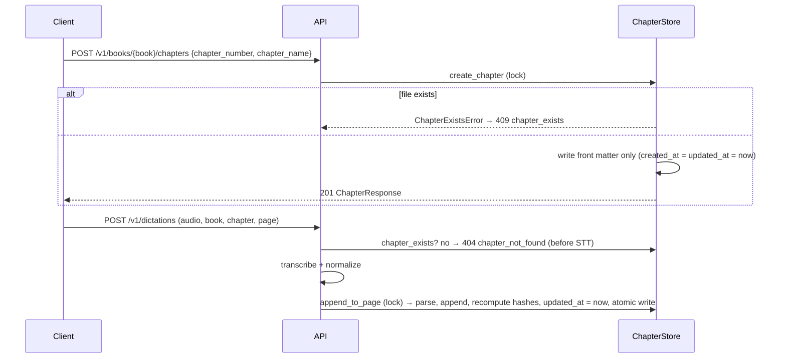

# Chapter Metadata, Create-Book & Create-Chapter APIs — Plan & LLD

> Status: **DRAFT, pending review**. Touches `app/storage/chapter_store.py`, `app/api/dictationer.py`, `app/schemas/dictation.py`.
> Companion files: `tasks/todo.yml` (plan, 2nd YAML document), `metric/chapter_metadata_test_cases.yml` (tests, pending review).

---

## 0. Decisions log

| # | Question | Decision |
|---|---|---|
| C1 | Header format | YAML-style **front matter** (`---` fences) at the top of `chapter-N.md`. Read and written by a small built-in `key: value` parser, with no new dependency. |
| C2 | Page header | `# page N, <page_hash>`. The hash is recomputed on every write and ignored on read, so a hand-edited file is never trusted. |
| C3 | `page_hash` | `sha256(page_content.encode("utf-8")).hexdigest()`. This is the same value the instructions LLD calls `content_sha256` (I4), so that feature reuses it. |
| C4 | `chapter_hash` | sha256 of the canonical page body: `"\n\n".join(f"# page {n}\n{content}")` over sorted pages, **without** hashes, front matter or preamble. Metadata-only changes (such as `updated_at`) don't change it. An empty chapter gets `sha256("")`. |
| C5 | Chapter name source | New **`POST /v1/books/{book_name}/chapters`** (header `author-id`, body `{chapter_number, chapter_name}`). |
| C6 | Dictating into a chapter that doesn't exist | **404 `chapter_not_found`**, checked *before* transcription so no STT cost is spent. ⚠ **Behaviour change**: before this, the chapter was created implicitly. Clients must create chapters first. |
| C7 | Legacy files (no front matter) | Still readable and writable. On their next append, front matter is added with `chapter_name: Chapter N`, `created_at` = file birth time (fallback: mtime) and `updated_at` = now. The preamble is kept. |
| C8 | `chapter_summary` | The key is written **empty**. AI summarization is **out of scope** (follow-up). |
| C9 | Timestamps | UTC, `YYYY-MM-DDTHH:MM:SSZ`. `ChapterStore` takes an injectable `clock` for tests. |
| C11 | Books | New **`POST /v1/books`** (header `author-id`, body `{book_name}`). It writes `{author}/{slug}/book.md` with front matter `book_name` (the display title, NFC) and `created_at`. **409 `book_exists`** if `book.md` exists. A legacy book folder without `book.md` is adopted (201). |
| C12 | Creating a chapter in a missing book | **404 `book_not_found`**. A book exists if its folder exists, so legacy books keep working without `book.md`. |
| C10 | Unknown front-matter keys | Kept in order and written back unchanged, so hand-added or future keys (e.g. `summary_hash`) survive. |

---

## 1. File format

```markdown
---
chapter_name: पहला अध्याय
created_at: 2026-10-19T10:02:11Z
updated_at: 2026-10-19T11:40:05Z
chapter_summary:
chapter_hash: 3b7e…(64 hex)
---

optional author preamble (kept as-is)

# page 1, 9f2c…(64 hex)
पहला पन्ना…

# page 2, 1ab4…(64 hex)
दूसरा पन्ना…
```

Key order is fixed: `chapter_name, created_at, updated_at, chapter_summary, chapter_hash`, followed by any unknown keys.
Values are single-line. Names are NFC-normalised and newlines are rejected at the API.

### Parse rules (lenient read, canonical write)
- Front matter only counts if the file **starts** with `---\n` and has a closing `---` line. If the closing line is missing, the file is treated as legacy (no front matter) and the text stays in the preamble.
- Each line is split on the first `": "` (or a trailing `":"` for an empty value), so names may contain `:`.
- Marker regex: `^#\s*page\s+(\d+)(?:\s*,\s*\S*)?\s*$`, case-insensitive. Old `# page 3` markers still parse.
- `script_normalizer` already escapes dictated lines that look like `#page N`, and its lookahead also covers the `, hash` suffix. A dictated `---` line can't start front matter because it never sits at the start of the file.

---

## 2. Flows



---

## 3. API

### `POST /v1/books` (new)
Header `author-id`. Body: `{ "book_name": "गोदान" }`, stripped, NFC, 1..128 chars, single-line.
- **201**: `{ "book": "<slug>", "book_name", "created_at" }`
- **409** `book_exists` (two titles with the same slug also collide, e.g. `My Book` and `my  book`)
- **422** for an invalid name or `invalid_book_name`; **400** `invalid_author_id`

### `POST /v1/books/{book_name}/chapters` (new)
Header `author-id`. Body (JSON):
```json
{ "chapter_number": 3, "chapter_name": "पहला अध्याय" }
```
| Field | Rule |
|---|---|
| `chapter_number` | int, 1..1000 (same bound as dictation) |
| `chapter_name` | stripped, NFC, 1..200 chars, no `\r` / `\n` |

Responses:
- **201**: `{ "book", "chapter", "chapter_name", "created_at", "updated_at", "chapter_hash" }`
- **409** `chapter_exists`
- **404** `book_not_found`
- **422** for an invalid name or number, or an invalid book name (existing `invalid_book_name`)
- **400** `invalid_author_id`

### `POST /v1/dictations` (changed)
Returns **404 `chapter_not_found`** if the chapter file is missing (C6). No other change.

### `GET /v1/books/{book}/chapters/{n}?page=N`
Unchanged. Content is returned without the hash suffix.

---

## 4. Code changes (minimal)

| File | Change |
|---|---|
| `storage/chapter_store.py` | `ChapterMeta` dataclass; `_split_front_matter` / `_render_front_matter`; marker regex accepts `, hash`; `serialize` writes front matter and `# page N, hash`; `page_hash()` / `chapter_hash()` helpers; `ChapterStore(root, clock=…)`; new `create_chapter`, `chapter_exists`; `append_to_page` raises `ChapterNotFoundError` if the file is missing and refreshes `updated_at` and `chapter_hash`; `ChapterExistsError` (409); `create_book`, `BookExistsError` (409), `BookNotFoundError` (404). |
| `schemas/books.py` (new) | `CreateBookRequest`, `BookResponse`, `CreateChapterRequest`, `ChapterResponse`. |
| `api/books.py` (new) | `POST /v1/books`, `POST /v1/books/{book}/chapters`. |
| `api/dictationer.py` | `chapter_exists` pre-check in `create_dictation`. |
| `tests/` | Update `test_chapter_store.py` / `test_dictation_api.py` for the new format (expected strings change; the scenarios don't). New CM-* tests. |

`parse` / `serialize` keep their shape (`parse → (meta, preamble, pages)`), and the round-trip property test stays.
