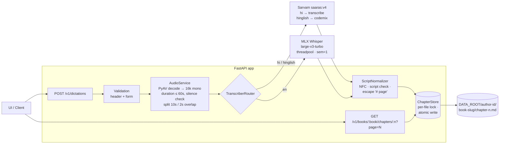
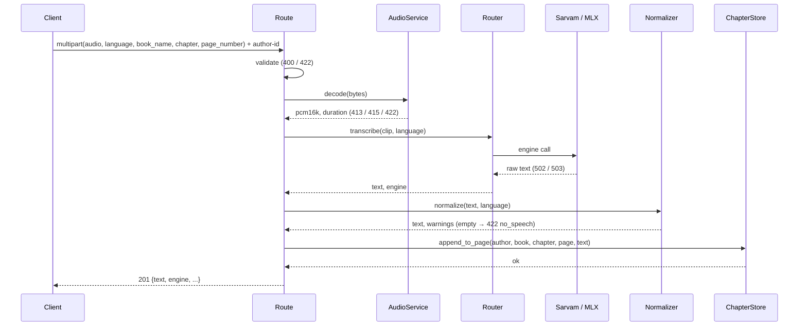
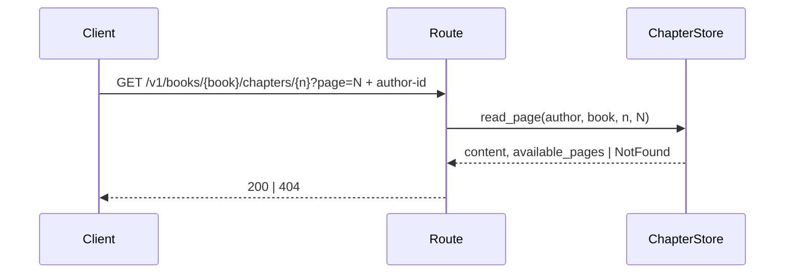
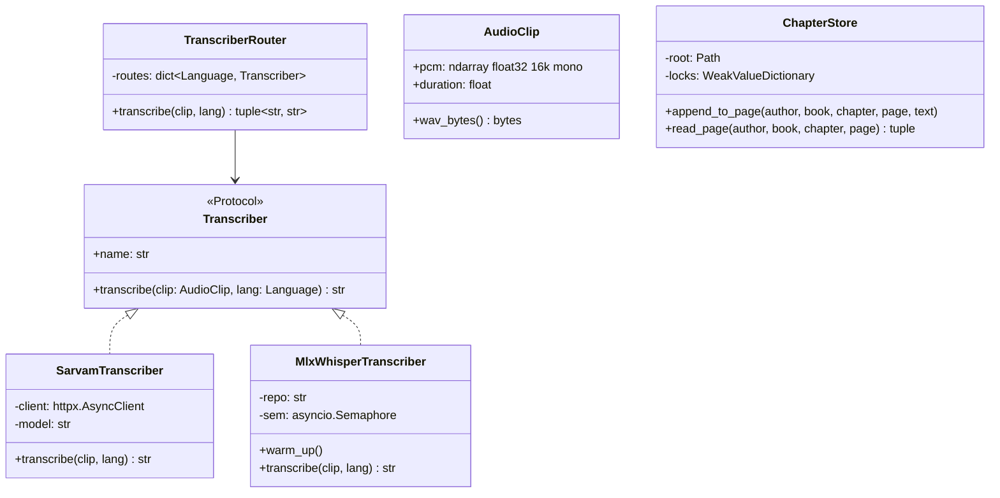
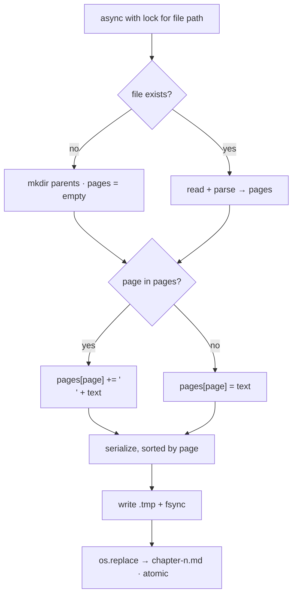
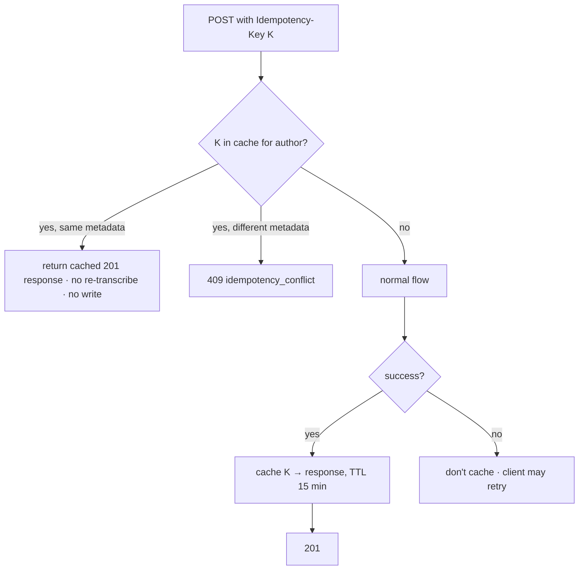

# Dictationer — Plan & LLD

> Status: **v2 — decisions locked, pending final approval**.
> Companion files: `tasks/todo.yml` (plan), `metric/test_cases_and_metrics.yml` (tests & metrics — **pending review**).

---

## 0. Decisions log

| # | Question | Decision |
|---|---|---|
| D1 | Chapter key | **Number** (`int ≥ 1`) in both POST and GET. No chapter title. |
| D2 | Hinglish script | Hindi words → **Devanagari**, English words → **Roman** (Sarvam `mode=codemix`). |
| D3 | New clip on existing page | **Append** (each clip on a new line). |
| D4 | Author folder | Folder name = **`author-id`** header value. |
| D5 | Sarvam model | **`saaras:v4`** (current default/latest per Sarvam docs); kept in config. |
| D6 | Audio decode | **PyAV** (`av`) — bundles ffmpeg libs; system `ffmpeg` is **not installed** on this machine. |
| D7 | File name | `chapter-{n}.md` |
| D8 | Client | **Mobile app** (iOS / Android) — see §2a. |
| D9 | Format detection | Never trust filename / `Content-Type` (mobile often sends `application/octet-stream`); detect by decoding. |
| D10 | Retry safety | Optional **`Idempotency-Key`** header so mobile retries don't append the same clip twice. *(proposed — needs approval)* |
| D11 | Duration tolerance | **0.25 s** (iOS/Android AAC encoder priming + stop-button lag). Configurable. |

---

## 1. Requirements

### Functional
| # | Requirement |
|---|---|
| F1 | `POST` accepts audio **≤ 60 s** (configurable; split into 10 s / 2 s-overlap segments, see §6.1a) + `language`, `book_name`, `chapter`, `page_number`; `author-id` header |
| F2 | `hi`, `hinglish` → **Sarvam `saaras:v4`**; `en` → local **`mlx-community/whisper-large-v3-turbo`** |
| F3 | `hi` → Devanagari; `en` → Roman; `hinglish` → code-mixed (Devanagari Hindi + Roman English) |
| F4 | Append text under the correct `# page N` marker in `{DATA_ROOT}/{author-id}/{book}/chapter-{n}.md` |
| F5 | `GET` returns a single page's content for the UI |

### Non-functional
- No path traversal through header / path params.
- No lost updates under concurrent writes to the same chapter.
- MLX model loaded once at startup; inference never blocks the event loop.
- p95 < 3 s per clip on the local Whisper path.
- **Backward compatible**: `/health`, request-id middleware, error envelope unchanged.

---

## 2. Existing codebase — findings & fit

| Finding | Impact / Action |
|---|---|
| `app/main.py` imports `app.api.router`, but `app/api/router.py` is **deleted** in the working tree and its content now lives in `app/api/dictationer.py` → **app currently fails to import**. | Restore `app/api/router.py` as the aggregator (original pattern, like `health.py`); `app/api/dictationer.py` holds only dictation routes. |
| `app/core/errors.py` has `AppError` + envelope `{error:{code,message,request_id}}`, snake_case codes. | All new errors subclass `AppError` — no new error format. |
| `app/core/config.py` has a `Settings` (pydantic-settings, `.env`). | Add new fields to the existing `Settings`; no new config class. |
| `tests/conftest.py` gives a `TestClient` fixture that runs lifespan. | MLX warm-up must be skippable in tests (`whisper_preload: bool` setting) and engines overridable via `app.dependency_overrides`. |
| mypy `strict = true`. | `mlx_whisper` is untyped → mypy override `ignore_missing_imports` for that module only. |
| `tests/` is listed in `.gitignore`. | ⚠️ Tests won't be committed. Flagging — your call. |
| Dev dependency **`httpx2`** (installed 2.13.1) — not the well-known `httpx`. | ⚠️ Looks like a typo / unknown package (possible supply-chain risk). Recommend removing; tests use `httpx` (already present via `fastapi[standard]`). Will **not** touch without your OK. |
| `app/agent/voice_agent.py` (faster-whisper, standalone script). | Untouched. |

---

## 2a. Mobile client — impact

| Concern | Mobile reality | Design response |
|---|---|---|
| **Formats** | iOS `AVAudioRecorder` → `.m4a` (AAC) or `.caf`; Android `MediaRecorder` → `.m4a` (AAC), `.3gp` (AMR-NB), `.ogg`/`.webm` (Opus); Expo / RN default → `.m4a` | PyAV (ffmpeg) decodes all of these. Accepted set: `m4a, aac, mp4, caf, 3gp, amr, ogg, opus, webm, wav, mp3`. |
| **m4a `moov` atom at end of file** | Default for both platforms | Decode from an in-memory **seekable** `BytesIO` (not a pipe) — pipes fail on these files. |
| **Interrupted recording** (phone call, app backgrounded) | Truncated m4a with no `moov` atom | Fails to decode → 415 `unsupported_audio`, nothing written. App should discard/redo. |
| **Content-Type** | Often `application/octet-stream` | Ignored; decode is the source of truth (D9). |
| **Duration** | Stop-button lag + AAC priming (~46 ms) push "60 s" clips slightly over | Tolerance 0.25 s (D11); app should cap recording at 60 s client-side too. |
| **Low gain / voice processing** | iOS voice-processing mode lowers level | Silence RMS threshold tuned on **real mobile clips** in E2E, not synthetic audio. |
| **Flaky network / auto-retry** | Client times out, retries → server already appended → **duplicate text** | `Idempotency-Key` header (D10), see §6.5. |
| **Client timeout** | Mobile HTTP clients default 10–60 s | Server worst-case budget ≤ 25 s (Sarvam 8 s × up to 3 tries, or Whisper queue 20 s + inference). App timeout should be **≥ 30 s**. |
| **Reachability** | Phone must reach the server running on your Mac (MLX is local) | Run uvicorn with `--host 0.0.0.0` on LAN, or a tunnel (Cloudflare Tunnel / ngrok) for outside LAN. ⚠️ See security note. |
| **CORS** | Not applicable to native apps | No change (existing CORS stays for the web FE). |

> ⚠️ **Security note:** `author-id` is a plain header — on a network any client can write to any author's books. Fine for LAN / personal use; before exposing via a tunnel, add at least a shared API key (`X-API-Key`). Out of scope for v1 unless you want it.

---

## 3. High-level architecture



### Sequence — POST


### Sequence — GET


---

## 4. API contracts

### 4.1 `POST /v1/dictations` — multipart/form-data

| Field | In | Type | Rules |
|---|---|---|---|
| `author-id` | header | str | `^[A-Za-z0-9_-]{1,64}$` |
| `Idempotency-Key` | header | str, optional | `^[A-Za-z0-9_-]{8,128}$` (app sends a UUID per clip) |
| `audio` | file | m4a / aac / caf / 3gp / amr / ogg / opus / webm / wav / mp3 | ≤ 12 MiB; decoded duration ≤ 60.0 s (+0.25 s tolerance) |
| `language` | form | `hi \| en \| hinglish` | required |
| `book_name` | form | str | 1–128 chars; must yield non-empty slug |
| `chapter` | form | int | 1 – 1000 |
| `page_number` | form | int | 1 – 10000 |

**201**
```json
{
  "text": "आज का topic है machine learning",
  "language": "hinglish",
  "engine": "sarvam",
  "book": "my-book",
  "chapter": 3,
  "page": 12,
  "warnings": []
}
```

### 4.2 `GET /v1/books/{book_name}/chapters/{chapter_number}?page=N`
Header `author-id`. `book_name` is slugified with the **same** function as POST, so `"My Book"` and `"my-book"` resolve to the same folder.

**200**
```json
{ "book": "my-book", "chapter": 3, "page": 12, "content": "...", "available_pages": [1, 2, 12] }
```

### 4.3 Errors (existing envelope `{error:{code,message,request_id}}`)

| Case | Status | `code` |
|---|---|---|
| Missing / invalid `author-id` | 400 | `invalid_author_id` |
| Malformed `Idempotency-Key` | 400 | `invalid_idempotency_key` |
| Same `Idempotency-Key` reused with different metadata | 409 | `idempotency_conflict` |
| Book name slugs to empty | 422 | `invalid_book_name` |
| Bad `language` / range / missing field | 422 | FastAPI default validation body (unchanged behaviour) |
| Audio > 12 MiB | 413 | `audio_too_large` |
| Undecodable / no audio stream | 415 | `unsupported_audio` |
| Duration > 60 s | 422 | `audio_too_long` |
| Silence / empty transcript | 422 | `no_speech` |
| Chapter file missing | 404 | `chapter_not_found` |
| Page missing in chapter | 404 | `page_not_found` |
| Sarvam timeout / 5xx / 429 after retries | 502 | `transcription_upstream_error` |
| MLX busy beyond wait budget | 503 | `transcriber_busy` |

---

## 5. Module layout (new files marked ✚, changed ✎)

```
app/
├── main.py                         ✎ lifespan: build transcribers, optional MLX warm-up, close httpx client
├── api/
│   ├── router.py                   ✚ (restored) aggregator: health + dictationer
│   └── dictationer.py              ✎ POST /v1/dictations, GET /v1/books/...
├── core/
│   ├── config.py                   ✎ + sarvam_api_key, sarvam_model, data_root, limits, whisper_*
│   └── errors.py                   (reuse AppError; no change)
├── schemas/dictation.py            ✚ Language enum, DictationResponse, PageResponse
├── services/
│   ├── audio.py                    ✚ decode → AudioClip(pcm, duration, wav_bytes)
│   ├── script_normalizer.py        ✚
│   └── transcription/
│       ├── base.py                 ✚ Transcriber Protocol
│       ├── sarvam.py               ✚
│       ├── mlx_whisper.py          ✚
│       └── router.py               ✚ Language → Transcriber
└── storage/chapter_store.py        ✚
```

**Dependencies:** `+ mlx-whisper`, `+ av`, `+ httpx` (explicit; already transitive). Dev: `+ respx`.



---

## 6. Component LLD

### 6.1 AudioService (`services/audio.py`)
1. Read upload with a hard cap: `await file.read(MAX + 1)` → `> MAX` ⇒ 413. (Never trust `Content-Length`.)
2. Decode with **PyAV** from a seekable `io.BytesIO` (required for mobile m4a with trailing `moov`) + `AudioResampler(format="flt", layout="mono", rate=16000)` → `np.float32` PCM. Filename / `Content-Type` ignored. Any `av.error.*` / no audio stream / zero samples ⇒ 415.
3. `duration = len(pcm) / 16000`; `> max_audio_seconds + audio_duration_tolerance_s` (60.25) ⇒ 422 `audio_too_long`. Uses decoded length, not container metadata.
4. Silence: `rms(pcm) < settings.silence_rms_threshold` ⇒ 422 `no_speech`.
5. `AudioClip.wav_bytes()` — encode PCM → 16-bit WAV with stdlib `wave`. Sarvam always receives **WAV** (browser `webm/opus` isn't in Sarvam's documented formats).
6. Decoding is CPU-bound but small (≤ 60 s) → runs in threadpool to keep the loop free.

### 6.1a Segmentation & merge (long audio)
Engines are tuned for short clips, so audio longer than `segment_seconds + audio_duration_tolerance_s` (10.25 s) is split; anything shorter is sent whole, exactly as before (1 engine call).
1. `audio.split`: `segment_seconds` (10 s) windows starting every `segment_seconds − segment_overlap_seconds` (8 s); the last window is clipped to the end and windows stop at the first one that reaches the end. 60 s ⇒ 8 windows: 0–10, 8–18, …, 48–58, 56–60. Windows are numpy views (no copy).
2. `TranscriberRouter.transcribe_many`: all windows in parallel, at most `segment_concurrency` (3) in flight; results kept in window order. Silent windows (`audio.is_silent`) are not sent (cost + Whisper hallucinates on silence). Whisper stays serialised by its own semaphore. Any failure cancels the remaining windows and fails the request — nothing is written (same atomicity as before).
3. `transcript_merge.merge`: engines give plain text (no timestamps), so the overlap is found on words (NFC + casefold, punctuation `P*` stripped; Devanagari marks kept). Within the last / first `segment_max_overlap_words` words, find the longest shared word run (≥ `segment_min_overlap_words`) that ends ≤ `segment_max_edge_words` (3) words before the end of the previous text and starts ≤ 3 words into the next; ties go to the run closest to the cut. The edge words outside the run are dropped on both sides — a word cut by the segment boundary is often garbled (seen with real Whisper: "…silver watch and a silver watch."), and each side has a clean copy of it. No match ⇒ joined with a space. A single repeated word (< min 2) is never removed, to avoid eating genuine repeats like "the the" / "है है".
4. `script_normalizer.normalize` runs once on the merged text.
5. Merge switch (for inspecting raw overlap): `segment_merge` setting (default `true`), overridden per request by `?merge=true|false`. With `false`, segment texts are appended as-is with a space (overlap repeated, no NFC / whitespace / script checks); only `script_normalizer.guard` runs — empty ⇒ 422 `no_speech`, page-marker lines escaped — so the chapter file can't be corrupted. The effective flag is part of the idempotency fingerprint (same key, different flag ⇒ 409).

### 6.2 Transcribers

**Sarvam (`sarvam.py`)**
```
POST https://api.sarvam.ai/speech-to-text
headers: api-subscription-key: <SARVAM_API_KEY>
multipart: file=<clip.wav>, model=saaras:v4, language_code=hi-IN,
           mode = {hi: "transcribe", hinglish: "codemix"}[lang]
response: { "transcript": "..." }
```
- One shared `httpx.AsyncClient` (created in lifespan, closed on shutdown), timeout 8 s (keeps worst case ≤ 25 s for mobile clients).
- Retries: 2, backoff 0.5 s → 1 s, **only** on timeout / 5xx / 429. Other 4xx ⇒ fail fast (502, logged with status — usually a bad key / bad request).
- Missing `SARVAM_API_KEY` ⇒ startup log warning; `hi`/`hinglish` requests ⇒ 502 with clear message (doesn't block `en`).

**MLX Whisper (`mlx_whisper.py`)**
```python
mlx_whisper.transcribe(clip.pcm, path_or_hf_repo=REPO, language="en", task="transcribe",
                       condition_on_previous_text=False)["text"]
```
- Runs via `run_in_threadpool`; guarded by `asyncio.Semaphore(1)` (Metal = one GPU). Acquire with `asyncio.wait_for(…, whisper_queue_timeout_s)` ⇒ 503 on timeout.
- `warm_up()` in lifespan transcribes 1 s of zeros → downloads/loads weights once. Disabled via `whisper_preload=false` (tests / CI).
- `language="en"` forced (no auto-detect drift); `condition_on_previous_text=False` reduces hallucination loops.

**Router (`router.py`)** — plain mapping, no if-chains:
```python
{Language.HI: sarvam, Language.HINGLISH: sarvam, Language.EN: whisper}
```
Exposed as a FastAPI dependency → tests override with fakes.

### 6.3 ScriptNormalizer (`services/script_normalizer.py`)
- `unicodedata.normalize("NFC")`, collapse whitespace, trim. Empty ⇒ 422 `no_speech`.
- Script **validation** (warn, never block, never transliterate) over letter chars only:
  - `hi`: Devanagari (U+0900–U+097F) ≥ 90 %.
  - `en`: Latin ≥ 90 %.
  - `hinglish`: Devanagari + Latin ≥ 95 %, and Devanagari > 0 (else warn "no Hindi detected").
  - Failure ⇒ `warnings: ["script_mismatch: ..."]` in response + log.
- **Marker guard**: lines matching `^\s*#\s*page\s+\d+` (case-insensitive) are escaped to `\# page N`.

### 6.4 ChapterStore (`storage/chapter_store.py`)

**Path:** `{DATA_ROOT}/{author_id}/{slug(book_name)}/chapter-{n}.md`

**`slug(book_name)`** — must support Devanagari titles:
- NFC → lowercase → whitespace runs → `-`.
- Keep a char iff `unicodedata.category(c)[0] in {"L", "M", "N"}` or `c in "-_"`.
  > Note: Python `\w` / `isalnum()` **drops Devanagari matras** (category `Mc`/`Mn`), e.g. `"गोदान"` would corrupt — hence category-based filter.
- Collapse `-+`, strip `-`. Empty ⇒ 422 `invalid_book_name`.
- Backstop: `path.resolve().is_relative_to(DATA_ROOT.resolve())` else 400.

**Format**
```markdown
# page 1
first clip text
second clip text

# page 2
...
```

**Parse:** regex `^#\s*page\s+(\d+)\s*$` (multiline, case-insensitive) → `dict[int, str]`. Text before the first marker is preserved as page-0 preamble (never lost on rewrite). Duplicate markers for the same page are merged in order.

**`append_to_page`**

- File I/O wrapped in `asyncio.to_thread`.
- Locks: `WeakValueDictionary[Path, asyncio.Lock]` — single process. **Run 1 uvicorn worker** (also avoids loading MLX N times). Multi-worker later ⇒ swap to `fcntl.flock` behind the same method.

**`read_page`** — no lock needed (atomic replace ⇒ readers never see partial files). Returns `(content, sorted(page numbers))` or `chapter_not_found` / `page_not_found`.

### 6.5 Idempotency (mobile retries) — *proposed, needs approval*

Problem: app sends clip → server appends → response lost on flaky network → app retries → **text appended twice**.



- Key scoped per author: `(author_id, K)`.
- Store: in-memory `TTLCache` (dict + expiry, max 10k entries) — single worker, simple. Lost on restart; acceptable since retries happen within seconds.
- Concurrent duplicate (retry arrives while first is still processing): per-key `asyncio.Lock` → second request waits and gets the cached result.
- Header **optional** → requests without it behave exactly as before (backward compatible).
- Metadata fingerprint = `(language, book_slug, chapter, page)`; audio bytes not hashed (keeps it cheap).

---

## 7. Config additions (`Settings`)

| Field | Default | Notes |
|---|---|---|
| `sarvam_api_key` | `""` | `.env` only |
| `sarvam_model` | `saaras:v4` | |
| `sarvam_base_url` | `https://api.sarvam.ai` | |
| `sarvam_timeout_s` | `8` | worst case ≤ 25 s for mobile |
| `whisper_model_repo` | `mlx-community/whisper-large-v3-turbo` | |
| `whisper_preload` | `true` | `false` in tests |
| `whisper_queue_timeout_s` | `20` | |
| `data_root` | `./data` | add `data/` to `.gitignore` |
| `max_audio_seconds` | `60.0` | was 10.0 |
| `audio_duration_tolerance_s` | `0.25` | mobile encoder priming / stop lag |
| `idempotency_ttl_s` | `900` | |
| `max_audio_bytes` | `12_582_912` | 12 MiB (was 4 MiB); fits 60 s 44.1 kHz stereo WAV |
| `segment_seconds` | `10.0` | §6.1a |
| `segment_overlap_seconds` | `2.0` | must be ≥ 0 and < `segment_seconds` (validated at startup) |
| `segment_max_overlap_words` | `12` | merge search cap |
| `segment_min_overlap_words` | `2` | smallest overlap that is removed |
| `segment_max_edge_words` | `3` | garbled words tolerated at each side of a cut |
| `segment_concurrency` | `3` | parallel engine calls per request |
| `segment_merge` | `true` | `false` ⇒ append segment texts raw (§6.1a.5); `?merge=` overrides |
| `silence_rms_threshold` | `0.003` | tune with real clips |

---

## 8. Edge cases (full list with scenarios in `metric/test_cases_and_metrics.yml`)

- Duration boundary: 60.0 / 60.25 accept, 60.3 reject. Segmentation / merge cases: `metric/long_audio_test_cases.yml`.
- Mobile formats: iOS m4a, iOS caf, Android m4a, Android 3gp/AMR, Android ogg/opus — all decode.
- m4a with `moov` at end → decodes; truncated m4a (interrupted recording) → 415.
- `Content-Type: application/octet-stream` → still decodes.
- Retry with same `Idempotency-Key` → single append, identical response.
- Size boundary: exactly 12 MiB accept, 12 MiB + 1 → 413.
- Empty / corrupt / video-only / text-as-`.wav` file → 415.
- Silence, or engine returns empty → 422, **nothing written**.
- Traversal via `author-id` (`../x`, `a/b`, `%2e%2e`) and `book_name` (`../../etc`, `/abs`).
- Devanagari book name (`गोदान`) — matras preserved; GET with same name finds it.
- Concurrent 10 appends → same page → all 10 lines present.
- Page insert order: existing 1, 9 + new 5 → 1, 5, 9.
- Hand-edited file (`#page 3`, `# Page 3`, preamble text) → parsed, preamble kept, canonical rewrite.
- Transcript containing `# page 7` → escaped; no phantom page.
- Sarvam 500 ×3 → 502; 429 then 200 → success; 401 → 502 immediately (no retry).
- MLX busy → 503 after queue timeout.
- `/health` and request-id behaviour unchanged.

---

## 9. Future (explicitly out of scope)
- Sarvam v4 `keyterms` biasing (e.g. character names per book).
- Multi-worker file locking (`fcntl`).
- Page edit / delete APIs, auth beyond `author-id` header (shared API key recommended before any tunnel exposure).
- Persistent idempotency store (survive restarts).

---

## 10. Sources
- [Sarvam — Saaras model (v4 default, v3, modes)](https://docs.sarvam.ai/api/getting-started/models/saaras.md)
- [Sarvam — Select output mode](https://docs.sarvam.ai/api/api-guides-tutorials/speech-to-text/how-to/select-output-mode.md)
- [Sarvam — Speech-to-Text REST API](https://docs.sarvam.ai/api/api-guides-tutorials/speech-to-text/rest-api.md)
