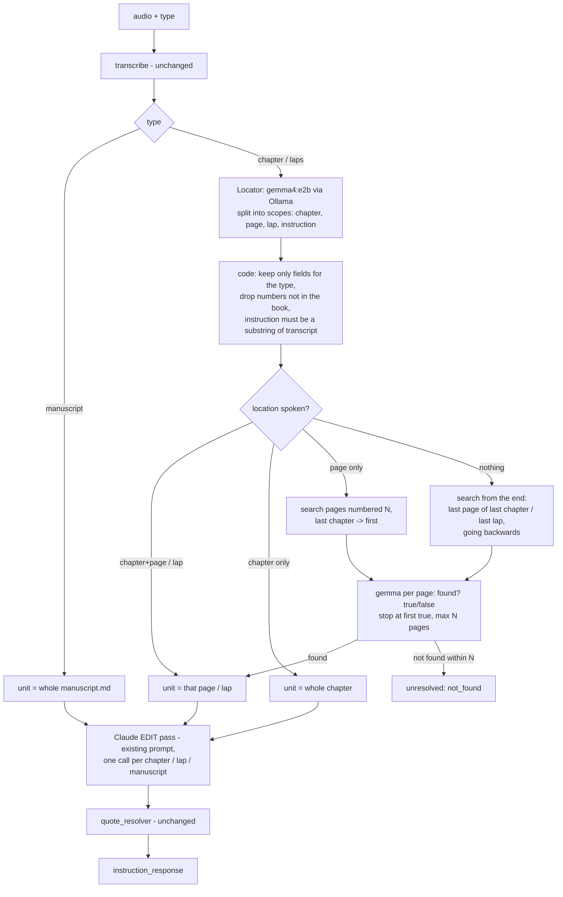

# /instructions v2 — locate first (local Ollama), then edit (Claude)

Status: APPROVED 2026-10-20. Tests: `metric/instructions_v2_test_cases.yml`.
Supersedes §6.3 (pass 1) and the whole-book fallback of §6.4 in `instructions_lld.md`.

## 1. Flow

## 2. Decisions

| # | Decision | Why |
|---|---|---|
| D1 | Locator and page search use **local Ollama `gemma4:e2b`** through the official `ollama` Python SDK (`AsyncClient.chat`, `format=<JSON schema>`, temperature 0). Claude (anthropic SDK) stays for the edit pass. | User request. Probe: 6/6 numbers right (Hindi / Hinglish / English number words, multi-edit split, lap). |
| D2 | The locator's `instruction` must be an **exact substring of the transcript** (whitespace-normalised). If not, that scope uses the whole transcript. | Probe: gemma dropped the target word ("…**flows** hata do" -> "hata do") and translated one instruction into English. |
| D3 | Fields that don't apply to the type are dropped in code: chapter type keeps chapter/page, laps keeps lap. Numbers that don't exist in the book become null (searched for, never trusted). | Same rule as today. |
| D4 | Search order "from the end": chapters descending, pages descending inside each; laps descending. First page gemma says `found=true` wins. | User: "start from the end". |
| D5 | Search stops after **`locator_max_pages` = 10** pages per scope -> `unresolved: not_found`. Probe: 6–8 s per page check, so 10 pages ≈ 1 min. | An unbounded search on a 100-page book would take ~10 min. |
| D6 | Chapter + page spoken (or found by search): Claude gets **only that page**. Chapter only: the whole chapter (as today). | "if found then send LLM": smaller, cheaper, more precise context. Behaviour change: today chapter+page sends the whole chapter. |
| D7 | Manuscript skips the locator: the whole manuscript + whole transcript go to one Claude call. Manuscript over `instruction_max_book_chars` -> 422 `book_too_large`. | User: "whole manuscript, no page". |
| D8 | Laps and manuscript are mapped into the existing `{chapter: {page: content}}` shape: laps = `{lap: {1: text}}`, manuscript = `{1: {1: text}}`. The response uses `chapter` = lap number and `page` = 1 for laps / manuscript (same convention as dictation / GET). The edit prompt gets one extra line naming the unit. | Reuses the edit prompt, quote_resolver and response schema unchanged. |
| D9 | `/accept?type=chapter|manuscript|laps`. Laps: path number = lap number, must equal body.chapter. Manuscript: numbers ignored. `page` ignored for both. Same sha check, all-or-nothing, lock as appends. | /instructions output must be acceptable for every type. Replaces the unapproved "/accept by type" draft (it had laps -> 422). |
| D10 | Ollama down / timeout -> 502 `locator_unavailable`; output not matching schema -> 502 `locator_bad_output`. Book-exists and Claude-configured checks still run before STT; the locator needs the transcript, so it runs after STT. | Same pattern as `llm_*` errors. |
| D11 | Several scopes needing search are searched one after another (Ollama runs one model on the GPU). Pages already checked for one scope are not re-sent for the same scope. | Concurrency would not be faster on one GPU. |

## 3. API changes

`POST /v1/instructions` (multipart): new optional field `type` = `chapter` (default) | `manuscript` | `laps`.
Response gains `type`. Unresolved reasons gain nothing new (`not_found` reused for "search ran out").

`POST /v1/books/{book}/chapters/{n}/accept?type=...`: response gains `type`.

## 4. Config (Settings, not secrets)

| Setting | Default |
|---|---|
| `ollama_host` | `http://localhost:11434` |
| `locator_model` | `gemma4:e2b` |
| `locator_timeout_s` | `120` (first call loads the model: 24 s seen) |
| `locator_max_pages` | `10` |

## 5. Modules

- ✚ `services/locator.py` — `Locator` (Ollama client): `find_scopes(transcript, type, outline)`, `page_matches(instruction, content) -> bool`.
- ✎ `services/instruction_extractor.py` — pass 1 replaced by Locator + search; pass 2 unchanged except context per unit (D6) and the unit line (D8).
- ✎ `storage/chapter_store.py` — `read_laps` (all laps, for search; `read_lap` / `read_manuscript` already exist), `apply_edits_manuscript`, `apply_edits_lap`, under the same per-file locks the REST and live-WS appends use.
- ✎ `api/instructions.py` — `type` on both routes.
- ✎ `main.py` — build `Locator` in lifespan.
- `uv add ollama`.

## 6. Behaviour vs main

- Pass 1 moves from Claude to local gemma: the existing IE-* pass-1 tests (FakeAgent returning `ScopeResult`) are rewritten against a fake Locator; edit-pass tests unchanged.
- No location spoken: was one whole-book Claude call (or 422 `book_too_large`); now a backwards search (no size limit, max 10 pages).
- Chapter + page spoken: Claude sees only that page (D6).
- Needs Ollama running for chapter / laps instructions (manuscript does not).

## 7. Out of scope / deferred (MVP, lesson L5)

- Parallel or batched page checks, caching page verdicts across requests.
- Retrying a busy / cold Ollama; falling back to Claude when Ollama is down.
- Instructions over the live WebSocket (`/v1/dictations/live` stays dictation-only).

- Splitting the manuscript into pages; searching inside a manuscript bigger than the budget.
- Running the page search on Claude.
